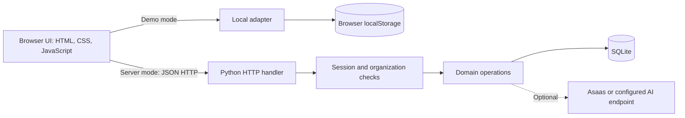

# Architecture and design decisions

## Execution modes

The public demonstration uses the same interface as the local application but runs the browser-side adapter instead of the HTTP API. It is intentionally isolated from production services. Business rules are implemented independently in both adapters, so their parity is not guaranteed by backend tests alone.

## Source layout

- `app.py`: HTTP routing, session authentication, validation, inventory, purchase and financial mutations.
- `operations.py`: reservations and accounts receivable.
- `commercial.py`: operational records, stock and optional payment/AI adapters.
- `schema.sql`: persistence schema and relationships.
- `static/`: browser application, styling and demo entry point.
- `tests/`: domain and HTTP integration tests, with temporary databases and mocked provider calls.
- `scripts/build_demo.py`: deterministic static demo generation.

## Data integrity

Every authenticated request resolves a user and organization from the session. Queries and mutations scope records to that organization. Writes run inside an immediate SQLite transaction; the API records idempotency keys and rejects keys reused with different payloads. An inventory shortage creates or updates an actionable issue. A receipt updates inventory, and a payment records an expense. Settling an open receivable creates one ledger entry and closes the record within the same transaction. Reservation dates are half-open intervals: a departure and another arrival on the same date can coexist.

## Security boundaries

The development server uses loopback by default, exact origin validation for JSON mutations, HttpOnly and SameSite Strict cookies, password hashing with scrypt, hashed session tokens, and basic security headers. Production still needs HTTPS, request rate limits, account recovery, hardened session management, backup/restore procedures, logging review, privacy safeguards and authorization for additional staff roles. SQLite requires persistent storage; it is not deployed as the public static demo. External integrations are opt-in, and provider credentials must stay in environment variables on the backend.
