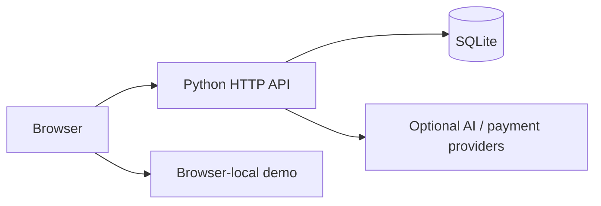

# Imovance — engineering quality / engenharia
Owner and maintainer: João Victor da Silva (JustJao1).
EN: Property operations, inventory, reservations and financial records.
PT: Gestão de imóveis, estoque, reservas e finanças.

ADR-001: Scope records by organization and validate permissions. ADR-002: Store money as integer cents; use transactions and idempotency keys. ADR-003: Keep demo records separate from the authenticated backend. See [existing architecture](architecture.md) and [API reference](api.md).
## Local container
Docker compose up --build --wait; open http://localhost:8000/demo. Data is kept in a local named volume; stop with docker compose down. No payment or AI credentials are included. Do not expose the local server as production.
## Verification
python -m unittest discover -s tests -v; node --check static/app.js. [CI](https://github.com/JustJao1/imovance/actions/workflows/engineering-quality.yml) produces real coverage and verifies Docker health.
## Demo (EN)
Open the fictional property, register a stock shortage, follow a purchase and inspect the financial ledger. Explain idempotent settlement and organization isolation.
## Demonstração (PT)
Abra um imóvel fictício, registre falta de estoque, acompanhe a compra e confira o financeiro. Explique idempotência e isolamento por organização.
## AI-assisted review
Review diffs, access controls, data migrations and test evidence before merging. Never send customer data or secrets to AI. The policy does not certify historical changes.
